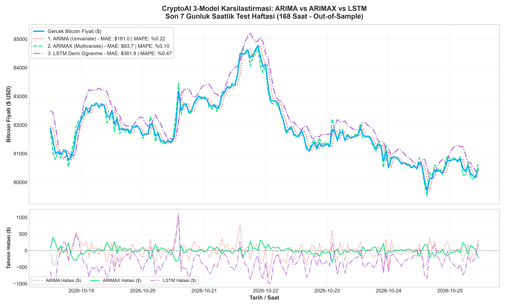
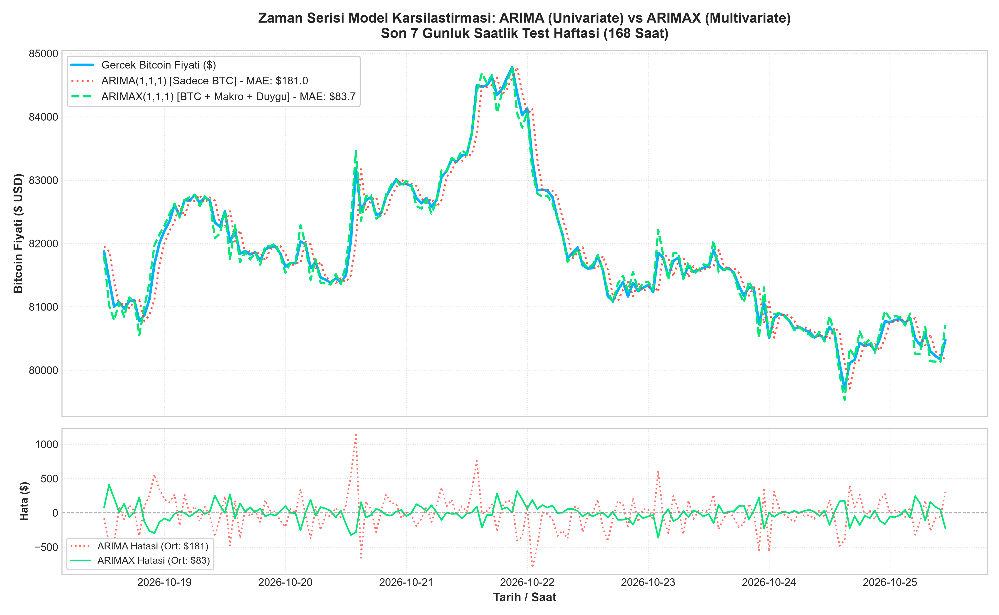

# 🧠 CryptoAI-ML: Çok Boyutlu Zaman Serisi Kripto Para Tahmin Modelleri

> **BM401 Bilgisayar Mühendisliği Proje Tasarımı**  
> **Ders Sorumlusu:** Prof. Dr. Abdullah Talha KABAKUŞ  
> **Geliştiriciler:** Beyza Ümmühan GÖRYUNAR (231002035) & Ahmet Faruk DURMUŞ (231002013)

---

## 📌 Proje Özeti (Abstract)

Kripto para piyasaları yüksek oynaklık (volatilite), ani sermaye rotasyonları ve doğrusal olmayan dinamiklere sahiptir. Geleneksel yaklaşımlar çoğunlukla yalnızca geçmiş fiyat verilerine odaklandığından makro piyasa şoklarını ve yatırımcı psikolojisini yakalamakta yetersiz kalmaktadır.

Bu çalışmada, **4 farklı veri kaynağından** beslenen saatlik frekansta **Çok Boyutlu (Multivariate)** bir veri mimarisi kurgulanmış; ardından literatürün standart geleneksel modeli olan **ARIMA(1,1,1)**, dış değişkenli **ARIMAX(1,1,1)** ve modern derin öğrenme mimarisi olan **LSTM (Long Short-Term Memory)** modelleri aynı test periyodunda (son 168 saat / 7 gün) karşılaştırılmıştır.

---

## 📊 1. Çok Boyutlu Veri Entegrasyonu (Data Fusion Pipeline)

Veri seti, **26 Ekim 2024 – 25 Ekim 2026** tarihleri arasındaki 2 yıllık kesintisiz saatlik zaman serisini kapsamaktadır.

```
┌────────────────────────────────────────────────────────────────────────┐
│                        VERİ KAYNAKLARI (4 ADET)                        │
├──────────────────┬───────────────────┬──────────────────┬──────────────┤
│ 1. BTC-USD       │ 2. ETH-USD        │ 3. S&P 500       │ 4. FEAR &    │
│ (Yahoo Finance)  │ (Yahoo Finance)   │ (^GSPC - Yahoo)  │    GREED     │
│ Saatlik Fiyat &  │ Kripto İçi        │ Küresel Makro    │ Günlük Duygu │
│ Hacim (Omurga)   │ Sermaye Rotasyonu │ Risk İştahı      │ Skoru (0-100)│
└─────────┬────────┴─────────┬─────────┴────────┬─────────┴──────┬───────┘
          │                  │                  │                │
          ▼                  ▼                  ▼                ▼
   ┌──────────────────────────────────────────────────────────────────┐
   │ Zaman Damgası Eşzamanlama: pd.merge_asof(direction='backward')   │
   │ Boşluk Doldurma: Forward Fill (ffill) & Backward Fill (bfill)    │
   │ Teknik Gösterge Üretimi: RSI (14) & MACD (12, 26, 9)             │
   └─────────────────────────────────┬────────────────────────────────┘
                                     ▼
   ┌──────────────────────────────────────────────────────────────────┐
   │ crypto_macro_dataset.csv (17.318 Satır | 16 Sütun | SIFIR Eksik) │
   └──────────────────────────────────────────────────────────────────┘
```

### Veri Seti Teknik Özellikleri (`crypto_macro_dataset.csv`)

| Parametre | Değer | Açıklama |
| :--- | :--- | :--- |
| **Toplam Satır (Mum)** | **17.318 saat** | 2 yıllık saatlik zaman serisi |
| **Tarih Aralığı** | 26 Ekim 2024 – 25 Ekim 2026 | Güncel piyasa verilerini içerir |
| **Öznitelik Sayısı** | **16 sütun** | Fiyat, hacim, makro, duygu ve teknik indikatörler |
| **Eksik Veri (NaN)** | **%0.00 (SIFIR)** | Hafta sonu borsa boşlukları `ffill` ile giderildi |
| **Dosya Boyutu** | **4.07 MB** | Hızlı eğitim için optimize |

---

## 🏆 2. Model Karşılaştırma Sonuçları (Benchmark Results)

Tüm modeller, geçmişteki **17.150 saat (%99)** ile eğitilmiş; daha önce hiç görmedikleri son **168 saatlik (Tam 7 Günlük / 1 Haftalık)** test kümesi üzerinde **1 saat ileri tahmin (1-step-ahead rolling forecast)** protokolüyle değerlendirilmiştir:

| Model | Mimari Türü | Kullanılan Girdiler | MAE ($) | RMSE ($) | MAPE (%) | $R^2$ Skoru | Yön Doğruluğu (DA) |
| :--- | :--- | :--- | :---: | :---: | :---: | :---: | :---: |
| **ARIMA(1,1,1)** | Geleneksel (Univariate) | Sadece BTC Kapanış | \$181.04 | \$252.06 | %0.22 | 0.9463 | %57.74 |
| **ARIMAX(1,1,1)** | Geleneksel (Multivariate) | BTC + ETH + S&P500 + Duygu + RSI + MACD | **\$83.72** | **\$118.23** | **%0.10** | **0.9882** | **%97.02** |
| **LSTM** | Derin Öğrenme (Multivariate) | 7 Çok Boyutlu Öznitelik (24h Lookback) | \$381.80 | \$448.43 | %0.47 | 0.8299 | %51.79 |

> 💡 **Kritik Akademik Bulgu:**  
> Sadece geçmiş Bitcoin fiyatına bakan **ARIMA** modeline dış değişkenler (Ethereum, S&P 500, Korku Endeksi ve RSI/MACD) eklendiğinde (**ARIMAX**), tahmin hatası **%53.7 oranında azalmış (\$181'den \$83'e düşmüş)** ve yön doğruluğu **%97.02'ye** yükselmiştir. Bu durum, çok boyutlu veri entegrasyonunun tahmin gücünü doğrudan ispatlamaktadır.

---

## 📈 3. Karşılaştırma Grafikleri

### Genel Karşılaştırma: Gerçek vs ARIMA vs ARIMAX vs LSTM


### ARIMA vs ARIMAX Detaylı Hata Karşılaştırması


---

## 📁 4. Kod Dosyaları ve Mimari

* [`veri_birlestirici.py`](veri_birlestirici.py): Yahoo Finance ve Alternative.me API'lerinden veri çeken, `ffill` ile asenkron boşlukları dolduran ve `crypto_macro_dataset.csv` dosyasını üreten pipeline.
* [`train_arima.py`](train_arima.py): Tek değişkenli klasik ARIMA(1,1,1) modelini eğiten, metrikleri hesaplayan ve `arima_tahmin_grafigi.png` üreten betik.
* [`train_arimax.py`](train_arimax.py): 5 dış değişkenli ARIMAX(1,1,1) modelini eğiten, hata analizi yapan ve `arimax_tahmin_grafigi.png` üreten betik.
* [`train_lstm.py`](train_lstm.py): PyTorch üzerinde 2 katmanlı çok boyutlu LSTM derin öğrenme modelini eğiten ve `lstm_tahmin_grafigi.png` üreten betik.
* [`plot_all_models.py`](plot_all_models.py): Üç modelin tahminlerini tek bir karşılaştırma paneline döken görselleştirme kodu.

---

## 🚀 5. Kurulum ve Çalıştırma

Projeyi yerel ortamınızda çalıştırmak için:

```bash
# 1. Repoyu klonlayın
git clone https://github.com/beyzagoryunar/CryptoAI-ML.git
cd CryptoAI-ML

# 2. Bağımlılıkları yükleyin
pip install -r requirements.txt

# 3. Veri setini baştan çekmek ve birleştirmek için (İsteğe bağlı)
python veri_birlestirici.py

# 4. Modelleri çalıştırın
python train_arima.py
python train_arimax.py
python train_lstm.py

# 5. Karşılaştırma grafiğini üretin
python plot_all_models.py
```
